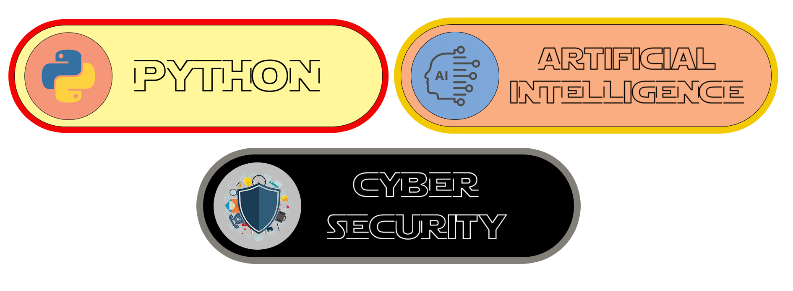

 

# Sachin B Pillai | SBP359

**Developer • Tech Enthusiast • Cybersecurity Learner**

Building, experimenting, learning, and turning ideas into projects.

---

## About Me

I'm Sachin, a student developer interested in technology, software development, and problem-solving.

I enjoy exploring different areas of computing, building practical projects, experimenting with new technologies, and understanding how things work under the hood.

- Exploring **Cybersecurity & Ethical Hacking**
- Building with **Python, JavaScript, and Web Technologies**
- Learning about **Artificial Intelligence & Machine Learning**
- Experimenting with software, automation, and development tools
- Participating in hackathons and collaborative projects

## Tech & Interests

**Areas of Interest**

| Domain | Technologies & Interests |
|---|---|
| Programming | Python, JavaScript |
| Web Development | HTML, CSS, React, Node.js |
| AI & ML | Machine Learning, Generative AI |
| Cybersecurity | Networking, Linux, CTFs, Ethical Hacking |
| Tools | Git, GitHub, VS Code, Kali Linux |

## Achievements

- 🏆 **AI VidyaSetu 1.0** – Zonal 2nd Runner-Up
- 🎯 Qualified for the National Level competition.
- 🏅 Top 10 in the INCTF Junior leaderboard.

## GitHub Statistics

 

## Contribution Activity

## Let's Connect

I'm always interested in connecting with people who enjoy building things, exploring technology, and sharing ideas.

---

*Keep learning. Keep building.*

